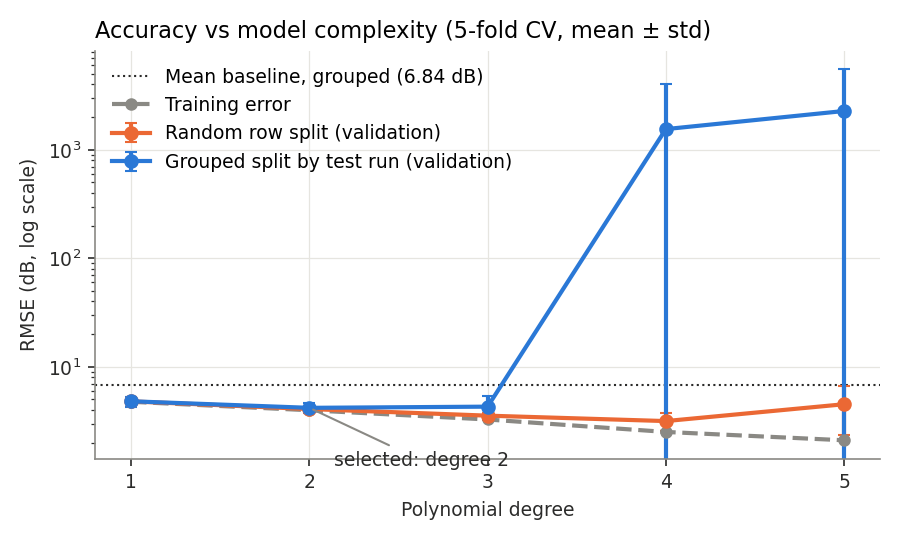

# Airfoil Self-Noise Prediction with Polynomial Regression

MMA3001 Numerical Methods and Machine Learning, individual project (2026).

Predicts the trailing-edge self-noise of a NACA 0012 airfoil section from its
operating conditions, as a fast early-stage screening tool for quiet wind
turbine and fan blade design. Polynomial regression is compared with a linear
baseline, and validated with a grouped split that holds out whole wind-tunnel
test runs.

> **Proof of concept.** Valid only within the tested range: NACA 0012,
> chord 0.025–0.30 m, 31.7–71.3 m/s, 0–22.2° angle of attack. It is not a
> replacement for wind-tunnel testing or aeroacoustic simulation.

## The engineering problem

Trailing-edge noise is the broadband "whoosh" made when turbulent air near a
blade's surface passes its sharp trailing edge. It drives noise limits on wind
farms and the design of quiet fans. Measuring it is expensive (wind-tunnel
tests), and simulating it takes hours to days per case (CFD and aeroacoustic
models). A regression model trained on existing measurements gives an
estimate in milliseconds.

**Why regression:** the target, sound pressure level in dB, is a continuous
number, so this is regression rather than classification. Polynomial terms
let the model capture smooth power-law trends and interactions between inputs
(e.g. frequency × velocity × boundary-layer thickness) that a straight-line
model cannot.

## Prediction contract

| | |
|---|---|
| **Unit of observation** | One one-third-octave frequency band from one wind-tunnel test run |
| **Target** | Scaled sound pressure level (SPL) in that band, dB |
| **Available inputs** | Frequency (Hz), angle of attack (deg), chord length (m), free-stream velocity (m/s), suction-side displacement thickness (m). All are known before the noise is measured. |
| **Deployment population** | Untested designs or operating conditions *within* the tested range |
| **Decision and cost** | Early noise screening. Underestimating noise risks a design that later fails noise limits; overestimating leads to over-conservative designs. |

### Inputs and outputs

| Input | Unit | Tested range |
|---|---|---|
| `frequency` | Hz | 200 – 20,000 |
| `aoa` (angle of attack) | deg | 0 – 22.2 |
| `chord` | m | 0.0254 – 0.3048 |
| `velocity` | m/s | 31.7 – 71.3 |
| `thickness` (displacement thickness) | m | 0.0004 – 0.0584 |

**Output:** predicted SPL (dB), plus an `in_tested_range` flag for each row.

**Invalid or unsupported inputs** (`check_inputs` in `data.py`):
- Missing columns, non-numeric values or missing values (NaN): error, no prediction.
- Zero or negative frequency, chord, velocity or thickness: error (physically impossible).
- Values outside the tested range: predicted, but a warning is raised and the row is flagged as an extrapolation.

## Data

NASA Airfoil Self-Noise dataset (Brooks, Pope & Marcolini, 1989), from the
[UCI Machine Learning Repository](https://archive.ics.uci.edu/dataset/291/airfoil+self+noise)
(id 291, CC BY 4.0 licence). 1,503 rows, 5 inputs, 1 target, no missing
values. The code downloads it with `ucimlrepo` on first run and caches a copy
in `data/`.

## Method

1. **Audit** the data (missing values, duplicates, validity, coverage) and
   label each row with its wind-tunnel test run (106 runs).
2. **Hold out 20% of test runs** as a final test set, used once at the end.
3. **Degree sweep 1–5** with 5-fold cross-validation, using both a
   **random row split** (`KFold`) and a **grouped split** by test run
   (`GroupKFold`). Records accuracy, overfitting gap, fit time, FLOPs and
   condition number.
4. **Select** the simplest degree within 5% of the best *grouped* RMSE.
5. **Final test**: mean baseline vs linear regression vs the selected polynomial.
6. **Checks**: physical trend (predicted noise rises with velocity),
   sensitivity (permutation importance), numerical conditioning, profiling.

Every model is a scikit-learn `Pipeline` (`StandardScaler` →
`PolynomialFeatures` → `LinearRegression`), so scaling is learned from the
training fold only, with no preprocessing leakage.

### Why the grouped split

Each test run gives 8–19 rows (one per frequency band) that share every input
except frequency. A random row split puts bands from the same run in both
training and validation, so the model is partly tested on runs it has already
seen. The grouped split keeps whole runs together, which matches deployment:
predicting a condition nobody has tested. A time-ordered split does not apply:
the runs have no timestamps and the task is not forecasting.

## Key results

*Numbers are produced by `run_all.py`; see `results/` for full tables.*

| Model (final test, unseen runs) | RMSE (dB) | MAE (dB) | R² |
|---|---|---|---|
| Mean baseline | 6.01 | 4.96 | −0.04 |
| Linear regression | 4.84 | 3.70 | 0.32 |
| **Polynomial degree 2 (selected)** | **4.82** | **3.61** | **0.33** |
| Polynomial degree 4 (random-split pick) | 10.66 | 5.66 | −2.29 |

- The **random split would have chosen degree 4**, which then failed badly on
  unseen runs. The grouped split chose degree 2.
- Degrees 4–5 break down because velocity was only tested at 4 speeds, so
  high powers of velocity add no new information and the least-squares matrix
  becomes nearly singular (condition number ~10¹⁶).
- Without `StandardScaler`, even degree 2 has a condition number of ~10¹²
  (about 40 with scaling).
- The model predicts noise rising with velocity in 99% of matched cases.



## Repository layout

```
Air-Foil-Noise/
├── src/airfoil_noise/     # the Python package
│   ├── data.py            # loading, audit, run grouping, input checks
│   ├── models.py          # baseline, linear and polynomial pipelines
│   ├── evaluation.py      # metrics, splits, cross-validation, degree sweep
│   └── plots.py           # report figures
├── tests/                 # pytest tests (37)
├── run_all.py             # runs the whole workflow
├── results/               # output tables (CSV/JSON/TXT)
├── figures/               # output figures (PNG)
├── docs/                  # HTML code documentation (pdoc)
├── reports/               # pytest HTML test report
├── AI_LOG.md              # record of AI use
├── requirements.txt
├── pyproject.toml
└── LICENSE
```

## How to run

### Google Colab

```python
!git clone https://github.com/ellrohde/Air-Foil-Noise.git
%cd Air-Foil-Noise
!pip install -q ucimlrepo pdoc pytest-html

!python run_all.py                     # results/ and figures/
!python -m pytest -v --html=reports/test_report.html --self-contained-html
!pdoc -d numpy -o docs ./src/airfoil_noise
```

### On your own computer

```bash
git clone https://github.com/ellrohde/Air-Foil-Noise.git
cd Air-Foil-Noise
pip install -r requirements.txt
python run_all.py
python -m pytest -v
```

Runs in under a minute. A fixed random seed (42) makes results repeatable.

## Documentation and tests

- **Code documentation:** open `docs/index.html` in a browser. It is
  generated by pdoc from the docstrings, which also note which unit week each
  method comes from ("Course link: Week X").
- **Tests:** 37 pytest tests in `tests/`, covering input validation, data
  audit, run grouping, metrics (checked against the Week 5.5 worked example),
  known-answer checks for the models, and that the grouped split never shares
  a run between training and validation. The HTML report is in
  `reports/test_report.html`.

## Limitations

- One airfoil shape (NACA 0012), small chords and low speeds; not valid for
  full-size wind turbine blades without new data.
- Only 4 velocities and 6 chords were tested, which limits how many polynomial
  terms the data can support.
- The polynomial cannot reproduce the peaked shape of individual spectra;
  typical error is ~4–5 dB on unseen runs.
- Using log₁₀(frequency) as an input is a promising improvement (lower grouped
  error in early testing).

## AI use

Claude (Anthropic) was used to help write code, tests and documentation.
See [`AI_LOG.md`](AI_LOG.md) for what it was used for, how its output was
checked, and errors it made.

## References

- Brooks, T. F., Pope, D. S. & Marcolini, M. A. (1989). *Airfoil Self-Noise
  and Prediction*. NASA Reference Publication 1218.
- Brooks, T., Pope, D. & Marcolini, M. (1989). Airfoil Self-Noise [Dataset].
  UCI Machine Learning Repository. https://doi.org/10.24432/C5VW2C

## Licence

MIT. See [LICENSE](LICENSE).
